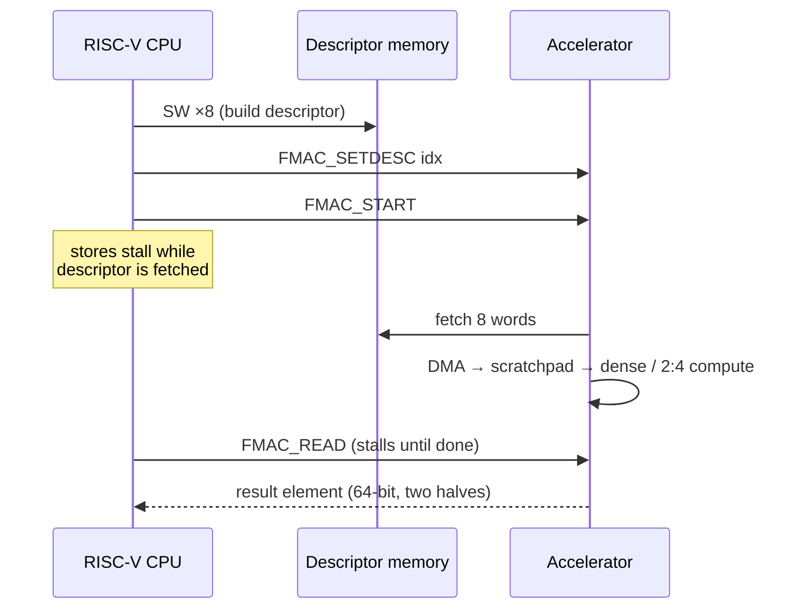
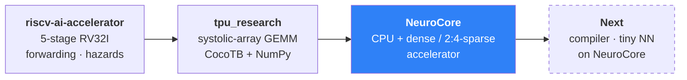

<!-- ===================================================================
     Profile README for github.com/SandyGowda-op
     Replace every {{PLACEHOLDER}} before publishing (search for "{{").
     Everything here renders natively on GitHub except the typing banner
     and view counter, which are images from free public services.
     =================================================================== -->

<h1 align="center">Hi, I'm Sandesh R Gowda 👋</h1>

  

  
  
  
  

---

### 🧠 About me

- 🎓 B.E in EEE at **BMSCE** 2027
- 🔧 I build and verify digital hardware for machine learning: RISC-V CPUs, matrix accelerators, and the CPU↔accelerator interface between them
- 🔬 What I care about: proving a fix works by showing the test **fails without it** (negative controls)
- 🌱 Currently: turning NeuroCore into a small NPU: result write-back, K-tile accumulation, and a compiler that picks dense vs 2:4-sparse per tile
- 🎯 Interested in: RTL design / design verification internships
- 📍 BANGALORE, India

---

### 🚀 Featured: NeuroCore

> A RISC-V CPU driving a descriptor-based accelerator that runs **dense 8×8** and **2:4-sparse** matrix jobs.

<table>
<tr>
<td width="50%" valign="top">

**What it is**
- 5-stage RV32I pipeline + 4 custom-0 instructions
- Descriptor fetch → DMA → scratchpad → compute
- Dense and 2:4-sparse paths behind one interface
- Hardware trusts software's sparsity layout → tiny control logic

</td>
<td width="50%" valign="top">

**What I measured**
- **9** CPU–accelerator coupling hazards found & fixed
- **3** negative controls that fail without their fix
- **23 / 23** regression checks, **50 / 50** random seeds
- Sparse vs dense: **1.80×** faster compute, **1.35×** per job
- Dispatch control ≈ **1.3 %** of accelerator area (Nangate45)

</td>
</tr>
</table>

  
  

<b>🔍 Click to see how the CPU talks to the accelerator</b>

<b>🐞 Click to see the hazards I found</b>

| Hazard | Fix | Proven by |
|---|---|---|
| 2nd `START` while busy is silently dropped | stall `START` | T1, H7 |
| ALU / `FMAC_READ` result → `BEQ` reads stale value | 1-cycle stall | T2, T3 |
| Invalid descriptor hangs the accelerator | error path + status read | T4 |
| 64-bit result truncated to 32 bits | high-word read | T5 |
| Read right after `START` returns old job's data | hold read | H2 |
| Store data not forwarded | forward into store path | T6b + negative control |
| Distance-3 read-after-write misses write-back | register-file bypass | T7 + negative control |
| Store right after `START` corrupts the descriptor | store guard | T6c + negative control |
| Pipeline registers missing in synthesis | remove `ifndef SYNTHESIS` | synthesis review |

---

### 🗺️ My hardware journey

| Repo | One line | |
|---|---|---|
| [**neurocore**](https://github.com/SandyGowda-op/neurocore) | CPU + descriptor-driven dense / 2:4-sparse accelerator, hazard study |  |
| [riscv-ai-accelerator](https://github.com/SandyGowda-op/riscv-ai-accelerator) | 5-stage RV32I pipeline with a coprocessor interface |  |
| [neurocore-accel](https://github.com/SandyGowda-op/neurocore-accel) | The accelerator on its own, with unit testbenches |  |
| [tpu_research](https://github.com/SandyGowda-op/tpu_research) | Parameterised systolic-array GEMM study |  |

---

### 🛠️ Toolbox

  
  
  
  
  
  
  
  
  
  
  
  

---

<b>💬 Ask me about…</b>

- why a branch resolved in ID needs a stall even with forwarding
- how a negative control proves a test can actually see a bug
- why a 1.80× compute speed-up becomes 1.35× end to end
- why one `always_comb` made every simulation compile take 2.5 minutes

Built with plain Markdown · last updated {{MONTH_YEAR}}

